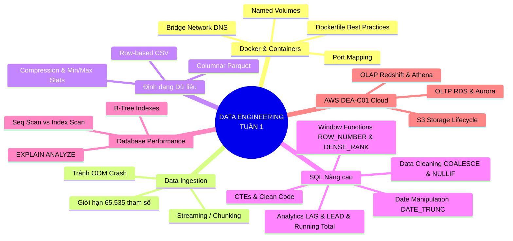
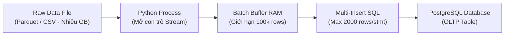
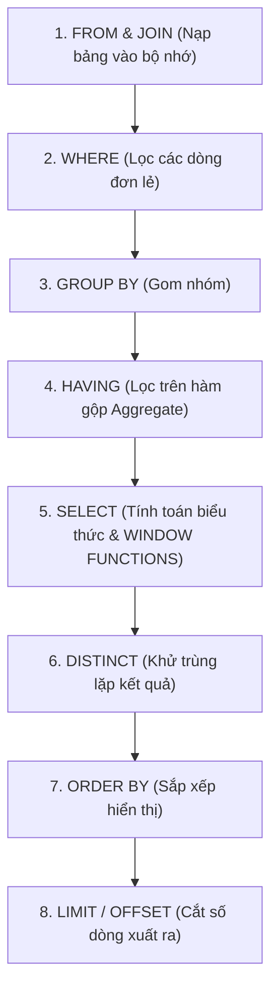
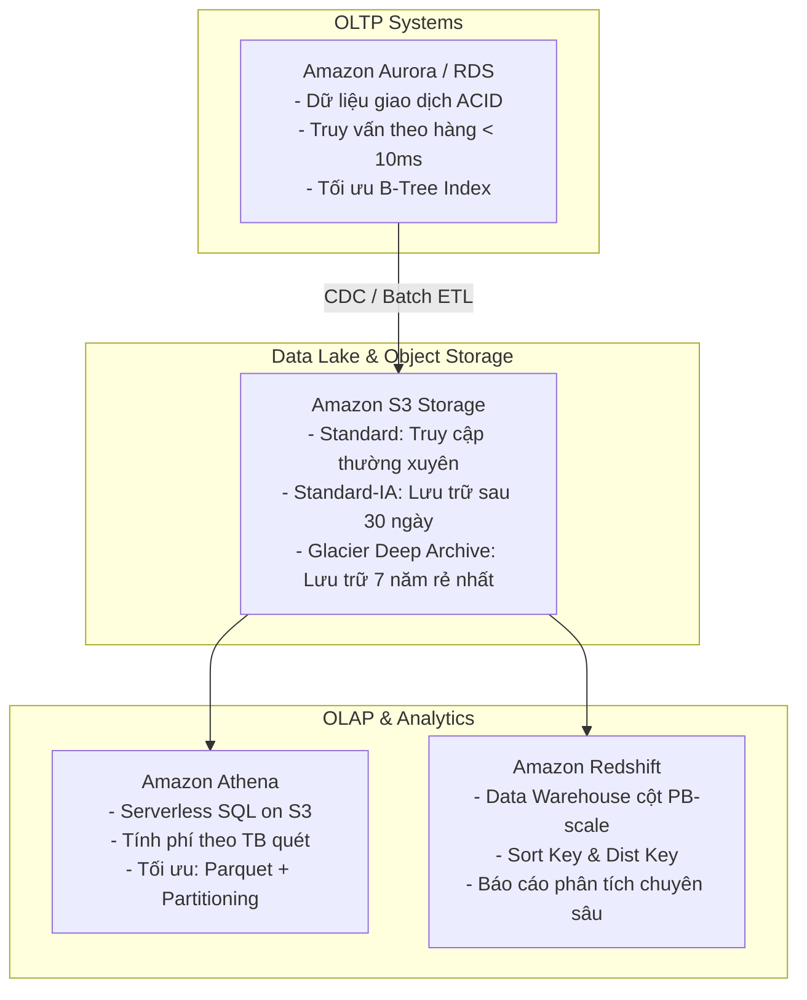

# 📘 BÁO CÁO TỔNG HỢP TOÀN DIỆN KIẾN THỨC DATA ENGINEERING (TUẦN 1)
> **Mục tiêu:** Nắm vững nền tảng Kỹ thuật dữ liệu (Data Engineering Foundations), thực chiến trên hệ thống cục bộ (Docker & PostgreSQL), chuẩn bị phỏng vấn Thực tập sinh (Intern/Fresher) và định hướng chứng chỉ **AWS Certified Data Engineer - Associate (DEA-C01)**.

---



---

## PHẦN 1: DOCKER & CONTAINERIZATION

### 1.1. Bản chất Docker Container & Port Mapping
* **Khái niệm:** 
  Container là môi trường chạy độc lập, đóng gói mã nguồn và toàn bộ thư viện phụ thuộc (dependencies) của ứng dụng. Khác với Máy ảo (Virtual Machine) phải ảo hóa cả phần cứng và cài nguyên một hệ điều hành riêng, Container chia sẻ chung nhân Linux (Kernel) của máy chủ nên nhẹ hơn gấp hàng chục lần, khởi động trong vài giây.
* **Cách dùng:**
  Cú pháp ánh xạ cổng: `ports: - "<CỔNG_MÁY_HOST>:<CỔNG_CONTAINER>"`.
* **Ví dụ (`docker-compose.yaml`):**
  ```yaml
  postgres:
    image: postgres:15-alpine
    ports:
      - "5432:5432" # Máy host mở localhost:5432 sẽ forward vào cổng 5432 của PostgreSQL
  ```
* **Trường hợp đặc biệt / Cạm bẫy thực tế:**
  > [!WARNING]
  > **Xung đột cổng (Port Conflict - Error `bind: address already in use`):**
  > Nếu máy tính của bạn trước đây đã cài PostgreSQL trực tiếp lên Windows, cổng `5432` trên máy thật đã bị chiếm. Docker sẽ báo lỗi không khởi động được.
  > *Cách xử lý:* Đổi cổng máy host thành `5433:5432`. Khi đó, kết nối từ máy thật sẽ trỏ vào `localhost:5433`.

---

### 1.2. Named Volumes & Tính chất Ephemeral
* **Khái niệm:**
  Container có tính chất **Ephemeral (tạm thời)**. Mọi file sinh ra trong quá trình container chạy đều ghi vào tầng bộ nhớ khả biến (Writable Layer). Khi container bị xóa (`docker rm` hoặc `docker compose down`), toàn bộ dữ liệu này **biến mất 100%**. Để bảo toàn dữ liệu, ta dùng **Named Volume** (mount thư mục ra ổ đĩa máy thật).
* **Cách dùng:**
  Khai báo `volumes:` trong service và khai báo ở cấp root của file compose.
* **Ví dụ:**
  ```yaml
  services:
    postgres:
      image: postgres:15-alpine
      volumes:
        - pgdata:/var/lib/postgresql/data # Gắn vùng nhớ vật lý
  volumes:
    pgdata: # Khai báo volume độc lập với vòng đời container
  ```
* **Trường hợp đặc biệt / Cạm bẫy thực tế:**
  > [!CAUTION]
  > Lệnh `docker compose down` chỉ xóa container và network, **không xóa volume**. Nhưng nếu bạn gõ:
  > `docker compose down -v` (cờ `-v` viết tắt của `--volumes`), Docker sẽ **xóa sạch toàn bộ volume và bay màu toàn bộ database**. Tuyệt đối không thêm cờ `-v` trên môi trường Production!

---

### 1.3. Docker Network & DNS Resolution
* **Khái niệm:**
  Docker cung cấp cơ chế mạng ảo (Bridge Network). Các container nằm trong cùng 1 mạng ảo sẽ tự động phân giải tên miền nội bộ (Internal DNS) thông qua **Service Name** đã khai báo trong compose.
* **Cách dùng:**
  Khai báo `networks:` và gán các service cần giao tiếp vào chung mạng.
* **Ví dụ:**
  Khi pgAdmin (trong container) muốn kết nối tới PostgreSQL (trong container), ta điền:
  * Host: `postgres` (Tên service, Docker tự đổi thành IP ví dụ `172.20.0.2`).
  * Port: `5432`.
* **Trường hợp đặc biệt / Cạm bẫy thực tế:**
  > [!IMPORTANT]
  > **Lỗi điền `localhost`:** Người mới hay điền `Host: localhost` vào pgAdmin. Kết quả bị báo lỗi `Connection refused`. Lý do: `localhost` đối với pgAdmin chính là bản thân container pgAdmin, chứ không phải container PostgreSQL.

---

### 1.4. Dockerfile: ENTRYPOINT vs CMD & Thứ tự Caching Layer
* **Khái niệm:**
  * `Dockerfile` là bản công thức định nghĩa cách build ra một image độc lập.
  * Docker build image theo từng lớp (Layers). Nếu một lớp không đổi, Docker dùng lại Cache để build cực nhanh.
* **Cách dùng:**
  * Luôn copy `requirements.txt` và chạy `pip install` **trước khi** copy mã nguồn `pipeline.py`.
  * Dùng `ENTRYPOINT` khi muốn container hoạt động như một công cụ dòng lệnh (CLI executable) nhận thêm tham số ngoài.
* **Ví dụ (`Dockerfile`):**
  ```dockerfile
  FROM python:3.11-slim
  WORKDIR /app
  # Copy requirements trước để tận dụng Docker Cache
  COPY requirements.txt .
  RUN pip install --no-cache-dir -r requirements.txt
  # Copy source code sau cùng (vì code thay đổi liên tục)
  COPY pipeline.py .
  ENTRYPOINT ["python", "pipeline.py"]
  ```
* **Trường hợp đặc biệt / Cạm bẫy thực tế:**
  Nếu bạn viết `COPY . .` lên dòng đầu tiên, mỗi lần bạn sửa 1 ký tự trong file Python, Docker sẽ **buộc phải chạy lại toàn bộ lệnh `pip install` từ đầu**, khiến thời gian build kéo dài thêm vài phút mỗi lần.

---

# PHẦN 2: DATA INGESTION & PIPELINE ARCHITECTURE



---

### 2.1. Kỹ thuật Chunking / Batching chống tràn RAM (OOM)
* **Khái niệm:**
  Trong kỹ thuật dữ liệu, không bao giờ nạp toàn bộ file vào RAM một lần (`pd.read_csv('file.csv')`). Nếu file 10GB, Pandas có thể tốn 30-40GB RAM để giải nén các kiểu dữ liệu dạng object, dẫn đến hệ điều hành lập tức kích hoạt `OOM Killer` (mã lỗi Exit code 137).
* **Cách dùng:**
  Dùng con trỏ lặp qua từng khối dữ liệu nhỏ (ví dụ 100,000 dòng/mẻ), xử lý xong thì ghi vào DB rồi mới đọc tiếp mẻ sau.
* **Ví dụ:**
  * Với Parquet: `pq.ParquetFile(path).iter_batches(batch_size=100000)`
  * Với CSV: `pd.read_csv(path, chunksize=100000, iterator=True)`
* **Trường hợp đặc biệt / Cạm bẫy thực tế:**
  Khi xử lý mẻ đầu tiên (`batch 0`), ta cần tạo schema bảng (`if_exists='replace'`). Nhưng từ các mẻ tiếp theo (`batch 1, 2...`), bắt buộc phải chuyển sang chế độ nối tiếp (`if_exists='append'`), nếu không toàn bộ dữ liệu trước đó sẽ bị ghi đè mất hết.

---

### 2.2. Giới hạn 65,535 tham số của giao thức PostgreSQL
* **Khái niệm:**
  Giao thức mạng nhị phân của PostgreSQL (PostgreSQL Wire Protocol) chỉ hỗ trợ tối đa số nguyên 16-bit không dấu ($2^{16} - 1 = \mathbf{65,535}$) tham số truyền vào một câu lệnh chuẩn bị trước (Prepared Statement).
* **Công thức tính an toàn:**
  $$\text{Safe Chunksize} = \frac{65,000}{\text{Số cột của bảng}}$$
* **Ví dụ:**
  Bảng taxi có 19 cột. Nếu ta nạp 10,000 dòng một lúc với `method='multi'`:
  $$10,000 \times 19 = \mathbf{190,000 \text{ tham số}} > 65,535 \implies \text{CRASH!}$$
  *Cách khắc phục:* Đặt `chunksize = 2000` dòng/lần chèn:
  $$2,000 \times 19 = \mathbf{38,000 \text{ tham số}} < 65,535 \implies \text{An toàn tuyệt đối!}$$

---

### 2.3. Bản chất định dạng file: Parquet vs CSV
* **Khái niệm:**
  * **CSV:** Lưu trữ hướng dòng (Row-oriented), định dạng văn bản thuần, không lưu metadata, không nén hoặc nén thô.
  * **Parquet:** Lưu trữ hướng cột (Columnar storage), mã hóa nhị phân, nén cực cao (Snappy/ZSTD), lưu sẵn Schema và Metadata (Min/Max giá trị).
* **So sánh trực quan:**
  | Tiêu chí | CSV | Parquet | Lợi ích trong Data Engineering |
  | :--- | :--- | :--- | :--- |
  | **Dung lượng (3 triệu dòng)** | ~500 MB | ~47 MB | Nhẹ hơn gấp 10 lần, tiết kiệm chi phí S3. |
  | **Đọc cột đơn lẻ** | Quét toàn bộ dòng | **Column Pruning** (chỉ đọc cột đó) | Giảm 90% lượng I/O ổ đĩa và RAM. |
  | **Lọc dữ liệu (`WHERE`)** | Đọc từng dòng | **Predicate Pushdown** (bỏ qua Row Group dựa vào Min/Max) | Tốc độ truy vấn nhanh gấp 20-50 lần trên Athena/Spark. |
  | **Bảo toàn kiểu dữ liệu** | Dễ lỗi String/Date | Chuẩn hóa Int32, Timestamp, Float | Tránh lỗi sai lệch dữ liệu khi ETL. |

---

# PHẦN 3: BẢN TỔNG HỢP SQL NÂNG CAO CHO DATA ENGINEER

---

### 3.1. Nhóm Hàm Làm Sạch Dữ Liệu (Data Cleaning)

#### A. Hàm `NULLIF(val1, val2)`
* **Khái niệm:** Trả về `NULL` nếu `val1 = val2`. Ngược lại trả về `val1`.
* **Mục đích vàng:** Chống lỗi chia cho 0 (**Division by Zero Crash**).
* **Cú pháp & Ví dụ:**
  ```sql
  -- Nếu fare_amount = 0, nó biến thành NULL -> Phép chia an toàn ra NULL thay vì sập pipeline
  SELECT 
      tip_amount,
      fare_amount,
      ROUND((tip_amount / NULLIF(fare_amount, 0) * 100)::numeric, 2) AS tip_rate
  FROM yellow_taxi_trips;
  ```
* **Trường hợp đặc biệt:**
  Không nhầm lẫn với hàm kiểm tra rỗng. `NULLIF(5, 0)` trả về `5`. Chỉ khi hai tham số bằng nhau nó mới sinh ra `NULL`.

#### B. Hàm `COALESCE(val1, val2, ...)`
* **Khái niệm:** Trả về giá trị đầu tiên **khác NULL** trong danh sách tham số.
* **Mục đích:** Gán giá trị mặc định cho các ô dữ liệu bị khuyết thiếu.
* **Cú pháp & Ví dụ:**
  ```sql
  -- Nếu passenger_count bị NULL thì tự gán là 1 khách
  SELECT 
      tpep_pickup_datetime,
      COALESCE(passenger_count, 1) AS clean_passengers
  FROM yellow_taxi_trips;
  ```

#### C. Biểu thức điều kiện `CASE WHEN`
* **Khái niệm:** Phép phân nhánh logic (`if-elif-else`) tiêu chuẩn của ANSI SQL.
* **Cú pháp & Ví dụ:**
  ```sql
  SELECT 
      trip_distance,
      CASE 
          WHEN trip_distance < 1.0 THEN 'Chuyến đi ngắn'
          WHEN trip_distance BETWEEN 1.0 AND 5.0 THEN 'Chuyến đi trung bình'
          ELSE 'Chuyến đi đường dài'
      END AS trip_category
  FROM yellow_taxi_trips;
  ```
* **Trường hợp đặc biệt:**
  Nếu không có nhánh `ELSE`, khi gặp điều kiện không khớp ở các nhánh `WHEN`, SQL sẽ mặc định trả về giá trị `NULL`.

---

### 3.2. Nhóm Hàm Xử Lý Thời Gian (Date & Time Manipulation)

#### A. Hàm `DATE_TRUNC('unit', timestamp)`
* **Khái niệm:** Cắt gọn phần thời gian về mốc bắt đầu của đơn vị mong muốn (`'hour'`, `'day'`, `'month'`, `'year'`), nhưng vẫn giữ nguyên kiểu dữ liệu TIMESTAMP.
* **Mục đích:** Tiêu chuẩn số 1 để tổng hợp dữ liệu (Aggregation) theo ngày/tháng trong Data Warehouse.
* **Cú pháp & Ví dụ:**
  ```sql
  -- Đưa '2023-01-15 14:35:28' về '2023-01-15 00:00:00'
  SELECT 
      DATE_TRUNC('day', tpep_pickup_datetime) AS trip_date,
      COUNT(*) AS total_trips,
      SUM(total_amount) AS revenue
  FROM yellow_taxi_trips
  GROUP BY 1
  ORDER BY trip_date ASC;
  ```

#### B. Hàm `EXTRACT(part FROM timestamp)`
* **Khái niệm:** Trích xuất riêng một thành phần con của thời gian thành con số nguyên độc lập (ví dụ lấy giờ từ 0 đến 23, thứ trong tuần từ 0 đến 6).
* **So sánh quan trọng:**
  * `DATE_TRUNC('day', '2023-01-15 14:00:00')` $\implies$ `'2023-01-15 00:00:00'` (Bảo toàn năm và tháng).
  * `EXTRACT(DAY FROM '2023-01-15 14:00:00')` $\implies$ Số `15` (Mất thông tin tháng và năm, chỉ dùng để phân tích ngày thứ 15 của các tháng khác nhau).

---

### 3.3. Nhóm Hàm Window Functions (Bậc Thầy Xếp Hạng & Phân Tích)

Cú pháp tổng quát:
$$\text{FUNCTION}() \text{ OVER } (\text{PARTITION BY } \text{cột\_phân\_nhóm } \text{ORDER BY } \text{cột\_sắp\_xếp } [\text{FRAME\_CLAUSE}])$$

#### A. Xếp hạng: `ROW_NUMBER()` vs `RANK()` vs `DENSE_RANK()`
| Hàm | Cơ chế đánh số khi có giá trị trùng lặp | Ví dụ kết quả xếp hạng | Ứng dụng tiêu biểu |
| :--- | :--- | :--- | :--- |
| **`ROW_NUMBER()`** | Không bao giờ trùng, đánh số tuần tự ngẫu nhiên | $1, 2, 3, 4$ | **Khử trùng lặp dữ liệu (Deduplication pattern)** |
| **`RANK()`** | Trùng giá trị thì đồng hạng, nhưng **nhảy cóc** số thứ tự sau | $1, 1, \mathbf{3}, 4$ | Thi cử (đồng hạng 1 thì không có giải nhì) |
| **`DENSE_RANK()`** | Trùng giá trị thì đồng hạng, **không nhảy cóc** số tiếp theo | $1, 1, \mathbf{2}, 3$ | **Xếp Top N doanh thu chuẩn xác** |

* **Code mẫu Deduplication (Câu hỏi phỏng vấn kinh điển):**
  ```sql
  WITH ranked_records AS (
      SELECT *,
          ROW_NUMBER() OVER (
              PARTITION BY trip_id               -- Nhóm theo mã định danh duy nhất
              ORDER BY tpep_pickup_datetime DESC -- Ưu tiên bản ghi cập nhật mới nhất
          ) AS rn
      FROM raw_trips
  )
  SELECT * FROM ranked_records WHERE rn = 1; -- Loại bỏ toàn bộ bản ghi trùng lặp
  ```

---

#### B. Phân tích chênh lệch: `LAG()` và `LEAD()`
* **`LAG(col, offset, default)`:** Lấy giá trị của dòng phía **trước** đó (quá khứ).
* **`LEAD(col, offset, default)`:** Lấy giá trị của dòng phía **sau** đó (tương lai).
* **Ví dụ đo khoảng cách thời gian giữa các chuyến taxi tại JFK:**
  ```sql
  SELECT 
      tpep_pickup_datetime,
      LAG(tpep_pickup_datetime) OVER (
          PARTITION BY "PULocationID" 
          ORDER BY tpep_pickup_datetime ASC
      ) AS prev_pickup_time,
      -- Tính số phút chênh lệch giữa 2 chuyến xe liên tiếp
      ROUND(
          EXTRACT(EPOCH FROM (tpep_pickup_datetime - LAG(tpep_pickup_datetime) OVER (
              PARTITION BY "PULocationID" ORDER BY tpep_pickup_datetime ASC
          ))) / 60.0, 2
      ) AS idle_minutes_gap
  FROM yellow_taxi_trips
  WHERE "PULocationID" = 132;
  ```

---

#### C. Tổng dồn lũy kế (Running Total) & Trung bình trượt (Moving Average)
* **Khái niệm:** Phép tính tích lũy tăng dần từ đầu kỳ đến thời điểm hiện tại.
* **Cú pháp & Ví dụ:**
  ```sql
  SELECT 
      trip_date,
      daily_revenue,
      -- Running Total: Cộng dồn từ ngày đầu tiên đến ngày hiện tại
      SUM(daily_revenue) OVER (
          ORDER BY trip_date ASC
          ROWS BETWEEN UNBOUNDED PRECEDING AND CURRENT ROW
      ) AS running_total_revenue,
      -- 3-Day Moving Average: Trung bình trượt của 2 ngày trước + ngày hiện tại
      AVG(daily_revenue) OVER (
          ORDER BY trip_date ASC
          ROWS BETWEEN 2 PRECEDING AND CURRENT ROW
      ) AS moving_avg_3d
  FROM daily_revenue_summary;
  ```

---

### 3.4. Thứ Tự Thực Thi Truy Vấn SQL (SQL Logical Execution Order)
> [!IMPORTANT]
> Tại sao không thể viết `SELECT ... WHERE ROW_NUMBER() OVER (...) = 1`?
> Vì thứ tự database xử lý các mệnh đề trong câu lệnh SQL khác hoàn toàn với thứ tự bạn viết trên màn hình!



* **Kết luận:** Mệnh đề `WHERE` (bước 2) chạy **trước** `SELECT` (bước 5). Do đó, tại thời điểm lọc `WHERE`, database chưa hề tính ra giá trị của Window Function! Bắt buộc phải bọc Window Function vào **CTE (`WITH ... AS`)** hoặc Subquery rồi mới lọc `WHERE` ở tầng bên ngoài.

---

### 3.5. Viết SQL Module Hóa: CTE (`WITH ... AS`) vs Subquery
* **Quy tắc Clean Code của Data Engineer:**
  Không bao giờ lồng Subquery 3-4 tầng gián tiếp (Anti-pattern). Luôn dùng CTE (Common Table Expression) để chia nhỏ bài toán thành các pipeline con rõ ràng, dễ bảo trì và dễ viết unit test.

---

# PHẦN 4: HIỆU NĂNG DATABASE & INDEXING STRATEGY

---

### 4.1. `EXPLAIN ANALYZE` và Các Kiểu Quét Dữ Liệu
* **Sequential Scan (`Seq Scan`):** Database phải đọc tuần tự từng block dữ liệu từ đầu đến cuối ổ cứng để tìm kiếm. Cực kỳ chậm khi bảng có hàng triệu bản ghi.
* **Index Scan (`Index Scan`):** Database duyệt trên cây tìm kiếm cân bằng B-Tree để định vị chính xác vị trí con trỏ vật lý (`TID`) của dòng cần tìm, chỉ tốn vài mili-giây.
* **Bitmap Index Scan:** Quét index tạo ra một mảng bitmap bộ nhớ rồi mới đọc dữ liệu, thường dùng khi kết quả trả về chiếm từ 1% đến 10% tổng số dòng.

---

### 4.2. Chiến Lược Đánh B-Tree Index & Composite Index
* **Quy tắc Tiền tố bên trái (Leftmost Prefix Rule) của Composite Index:**
  Nếu bạn tạo một chỉ mục hỗn hợp trên 2 cột: `CREATE INDEX idx_pu_dt ON yellow_taxi_trips ("PULocationID", tpep_pickup_datetime);`
  * Câu query lọc: `WHERE "PULocationID" = 132 AND tpep_pickup_datetime = '...'` $\implies$ **Dùng Index tối ưu**.
  * Câu query lọc: `WHERE "PULocationID" = 132` $\implies$ **Dùng Index tối ưu**.
  * Câu query lọc: `WHERE tpep_pickup_datetime = '...'` (Không có `PULocationID`) $\implies$ **Bị Bỏ qua Index, quay về Seq Scan!**
* **Trường hợp đặc biệt / Cạm bẫy:**
  > [!WARNING]
  > **Hình phạt ghi dữ liệu (Write Penalty):**
  > Index giúp câu lệnh `SELECT` nhanh gấp 100 lần, nhưng sẽ làm các câu lệnh `INSERT`, `UPDATE`, `DELETE` chậm đi rõ rệt vì mỗi khi thêm 1 dòng, database phải cập nhật lại cấu trúc cây B-Tree. Do đó, trong hệ thống Data Pipeline, người ta thường **DROP Index trước khi nạp dữ liệu lớn hàng loạt, sau khi nạp xong mới CREATE Index lại**.

---

# PHẦN 5: GÓC NHÌN CHỨNG CHỈ AWS CERTIFIED DATA ENGINEER (DEA-C01)



### 5.1. Bảng So Sánh Kiến Trúc: OLTP vs OLAP trên AWS
| Tiêu chí | OLTP (Amazon Aurora / RDS) | OLAP (Amazon Redshift / Athena) |
| :--- | :--- | :--- |
| **Bản chất lưu trữ** | **Row-oriented (Hướng dòng)** | **Columnar (Hướng cột)** |
| **Loại công việc** | Hàng ngàn giao dịch ghi/đọc nhỏ lẻ mỗi giây. | Quét hàng chục triệu/hàng tỷ dòng để tính toán báo cáo tổng hợp. |
| **Độ trễ truy vấn** | **Mili-giây (< 10ms)** | Vài giây đến vài phút |
| **Đảm bảo tính chất** | Tuân thủ tuyệt đối **ACID** | Khả năng mở rộng theo chiều ngang (Horizontal Scaling) |
| **Ví dụ thực tế** | Hệ thống đặt cuốc xe taxi, cập nhật số dư ví tài xế. | Hệ thống phân tích doanh thu cả năm, dự báo xu hướng nhu cầu đi lại. |

---

### 5.2. Tối Ưu Chi Phí Amazon S3 Lifecycle (Câu hỏi 100% ra thi)
* **S3 Standard:** Lưu trữ dữ liệu nóng (Hot data), dữ liệu mới nạp trong 30 ngày đầu.
* **S3 Standard-Infrequent Access (S3 Standard-IA):** Dữ liệu ít truy cập sau 30 ngày (vẫn truy cập trong mili-giây nhưng phí lưu trữ rẻ hơn một nửa, bù lại có phí khi đọc dữ liệu).
* **S3 Glacier Flexible Deep Archive:** Dữ liệu lưu trữ dài hạn phục vụ kiểm toán thuế/pháp lý (thời gian khôi phục 12 tiếng). Chi phí siêu rẻ: chỉ **\$0.00099 / GB / tháng** (rẻ gấp 23 lần S3 Standard).

---

# 📋 TỔNG KẾT BẢNG MÃ LỆNH & KIẾN THỨC CẦN GHI NHỚ

1. **Docker Command:**
   * Khởi chạy ngầm: `docker compose up -d`
   * Xem logs: `docker compose logs -f <service>`
   * Tắt hệ thống an toàn: `docker compose down` (không dùng `-v` nếu muốn giữ dữ liệu).
2. **SQL Best Practices:**
   * Chống sập chia 0: Dùng `NULLIF(mau_so, 0)`.
   * Khử trùng lặp: `ROW_NUMBER() OVER (PARTITION BY id ORDER BY updated_at DESC)` lấy `WHERE rn = 1`.
   * Gom nhóm theo ngày: `DATE_TRUNC('day', pickup_time)`.
   * Luôn dùng `UNION ALL` thay vì `UNION` nếu dữ liệu đảm bảo không bị trùng (tăng tốc độ gấp 2-5 lần).
3. **Data Pipeline Mindset:**
   * Luôn đọc file theo chunk (100k dòng) chống tràn RAM.
   * Tính toán chunk chèn vào database không vượt quá giới hạn 65,535 tham số.
   * Ưu tiên định dạng Apache Parquet hơn CSV trên môi trường Cloud Data Lake.
